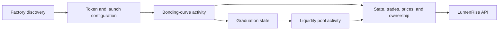

# LumenRise Launch

**From launch contracts to a coherent view of a token's lifecycle.**

LumenRise brings identity, reputation, and token launch activity into one platform. This repository provides its blockchain indexing layer: it follows Stellar and Base contracts and builds the project, price, trade, and ownership records that power launch discovery.

A launch is more than a deployment event. Its configuration, trading activity, graduation state, and subsequent market all change over time. LumenRise Launch keeps those observations connected to the same project.

[Launch lifecycle](#launch-lifecycle) | [Core technology](#core-technology) | [Platform architecture](#platform-architecture) | [Getting started](#getting-started)

## Launch lifecycle



Launch contracts define the sale and its economic rules. This service reads their configuration and follows their state, preserving the context needed to present each stage through LumenRise.

## Core technology

### Factory-based project discovery

Discovery starts from configured factory contracts. Each indexed launch is tied to its originating factory, launch contract, owner, token, and payment asset.

The project record combines token identity and descriptive metadata with contract configuration, including allocation buckets, vesting parameters, curve settings, and start time where present. This gives the platform both the project's presentation and its recorded launch terms.

### Bonding-curve state

During a launch, the indexer follows contract state and price observations. Sold amounts, reserve-related state, and graduation status allow the API to present progress alongside trading activity.

State and price readings retain their blockchain observation context. On Stellar, the worker checks that a price reading is not behind its associated state observation before storing it.

### Graduation and liquidity tracking

For Base launches, the service follows graduation into the associated Uniswap v4 pool. It verifies the pool against the launch's graduation record and token pair, then reads pool state, liquidity, and swap activity.

Price tracking follows the active market: launch-contract pricing before graduation and pool-derived pricing after graduation. Both stages remain associated with the original launch record.

### Market and ownership history

| Data                           | Purpose                                             |
| ------------------------------ | --------------------------------------------------- |
| Launch configuration and state | Describe launch terms and observed progress         |
| Trades                         | Build transaction history and activity views        |
| Price samples                  | Support charts and market history                   |
| Holder records                 | Describe token ownership through refreshed balances |
| Asset identity and metadata    | Connect project presentation to blockchain assets   |

Market history reflects the transactions and observations collected by the platform. Stored chain context and timestamps let consumers interpret those records against their source.

### Recoverable synchronization

Persistent cursors track scan progress so indexing can resume. Base block checkpoints support chain reconciliation: when a reorganization changes previously observed blocks, affected records can be removed and processed again.

Scheduled state updates, holder refresh jobs, and retry handling keep different parts of the index moving without requiring a client request. Stellar asset identity synchronization and token image finalization also keep project records connected to their confirmed assets.

## Platform architecture

| Component                                                         | Role                                                                         |
| ----------------------------------------------------------------- | ---------------------------------------------------------------------------- |
| **[Launch](https://github.com/poconik/lumenrise-launch)**         | Converts contract state and blockchain events into launch and market records |
| **[API](https://github.com/poconik/lumenrise-api)**               | Serves project discovery, market views, and participant-facing features      |
| **[Reputation](https://github.com/poconik/lumenrise-reputation)** | Processes account history and participant activity evidence                  |

The indexer writes to the platform's shared MongoDB database and uses RabbitMQ for holder refresh work. It runs as a background service. The API combines its output with project and team information for clients.

## Getting started

**Requirements:** Node.js 24+, npm, a MongoDB replica set, RabbitMQ, and access to configured blockchain providers and deployed factory contracts.

```sh
npm ci
cp .env.example .env
```

Configure [`.env.example`](.env.example) values in `.env`. Match the API's database and broker connections. Supply Stellar provider and factory settings for Stellar indexing; configure the Base RPC, factory address, and deployment block together for Base indexing. Apply the API's migrations to the shared database before starting workers.

```sh
npm run dev
```

For production, run `npm run build` followed by `npm start`, supplying configuration through environment variables.

**Docker:** Start the API Compose stack and complete its migrations first. It provides MongoDB and RabbitMQ on the shared `lumenrise` network. Set matching database and broker credentials in this repository's `.env`, then run `docker compose up -d --build`. See [compose.yml](compose.yml).

## Engineering

Built with **TypeScript and Node.js**, **MongoDB**, and **RabbitMQ**. **Stellar SDK, Horizon, and Soroban RPC** provide Stellar access; **viem** provides Base contract and event access.

Run `npm run check` for TypeScript checks, `npm run lint` for code checks, and `npm test` for tests. See [`package.json`](package.json) for all commands.

## License

[MIT](LICENSE).
